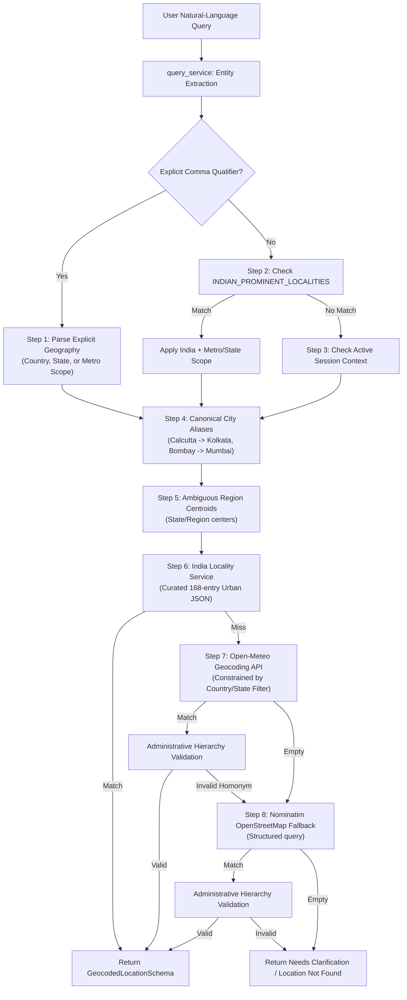
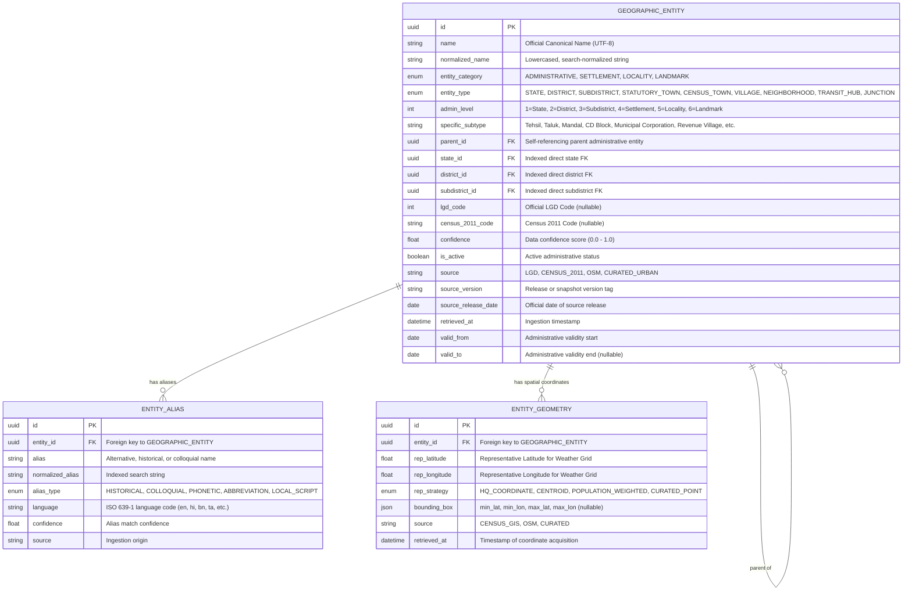
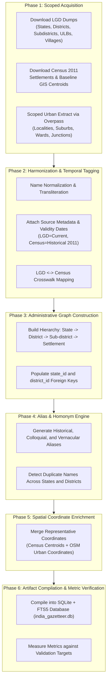
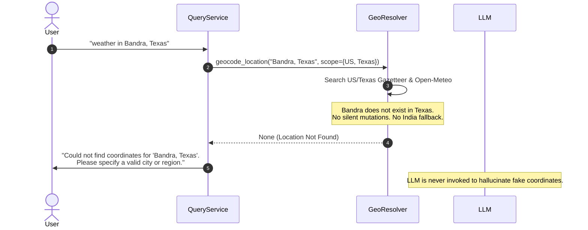
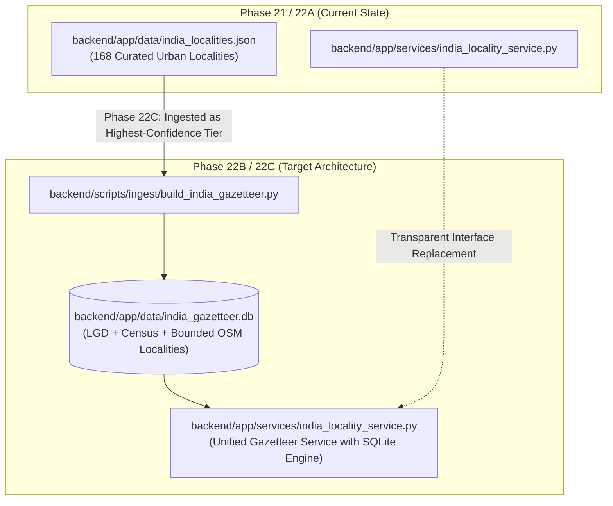

# Nationwide India Geographic Resolution Architecture

> **Document ID**: `STORM-ARCH-2026-PHASE22A`  
> **Status**: APPROVED ARCHITECTURE & RESEARCH DESIGN (REVISED)  
> **Target Scope**: Nationwide Indian Geographic Hierarchy, LGD/Census Ingestion, and Disambiguation Engine  
> **Phase**: Phase 22A (Data Architecture & Research Only — No runtime logic changes)

---

## 1. Executive Summary & Current Architecture

StormOps currently resolves geographic queries through a hybrid resolver in [`backend/app/services/geocoding_service.py`](file:///c:/StormOps/backend/app/services/geocoding_service.py) coupled with a curated index in [`backend/app/services/india_locality_service.py`](file:///c:/StormOps/backend/app/services/india_locality_service.py) and data store [`backend/app/data/india_localities.json`](file:///c:/StormOps/backend/app/data/india_localities.json).



### Current Strengths
1. **Explicit Geography Preservation**: Explicit geographic qualifiers (e.g. `"Park Street, London"`, `"Bandra, Texas"`, `"Newtown, West Bengal"`) are extracted intact and strictly override conversational session context.
2. **Deterministic Fast-Path**: Known urban neighborhood queries (e.g. `"Park Street"`, `"Gariahat"`, `"Bandra"`, `"Koramangala"`) resolve locally without third-party network latency.
3. **Foreign Homonym Defense**: Administrative hierarchy validation rejects foreign homonyms (e.g. preventing Maniktala from resolving to a village in Bangladesh).

---

## 2. Problems with the Curated 166-Entry Approach

While the 168-entry curated JSON dataset satisfies targeted regression tests across 30 cities, it is fundamentally inadequate as a nationwide geographic system:

1. **Severe Coverage Ceiling**: India encompasses 28 States, 8 Union Territories, ~788 Districts, ~6,000 Sub-districts (Tehsils/Taluks/Mandals/Blocks), ~8,000 Statutory and Census Towns, and over 640,000 Rural Revenue Villages. A hand-curated list of 168 entries covers less than 0.02% of Indian settlements.
2. **Metropolitan Bias**: Current entries exclusively represent Tier-1 metropolitan neighborhoods (e.g., South Kolkata, South Mumbai, Central Bengaluru). Significant industrial, educational, and commercial Tier-2/Tier-3 cities (e.g., Durgapur, Asansol, Siliguri, Bardhaman, Warangal, Tirupati, Kolhapur, Hubballi) and entire rural blocks are completely omitted.
3. **Manual Maintenance Bottleneck**: Curating entries by hand violates software scalability principles. Administrative boundaries, district reorganizations, and newly classified census towns cannot be maintained manually.
4. **Missing Authoritative Linkage**: The JSON records lack authoritative government identifiers (such as LGD or Census codes). When states bifurcate or reorganize administrative units, static JSON records become orphaned or inconsistent.
5. **Vulnerability to Provider Heuristics**: For locations outside the 168 entries, resolution falls back to Open-Meteo and Nominatim. Open-Meteo ranks results purely by global population estimates, frequently ranking tiny foreign hamlets above major Indian administrative blocks.

---

## 3. Place Identity vs. Representative Weather Coordinate

A foundational architectural requirement for StormOps is the strict separation between **Place Identity** and **Representative Weather Coordinate**:


### Core Principles
1. **Locality is Not a Single Point**: A locality, neighborhood, or administrative boundary is an area, polygon, or spatial jurisdiction—not intrinsically a single mathematical point. However, weather forecast APIs (such as Open-Meteo) require specific latitude/longitude pairs to query grid models.
2. **Decoupled Architecture**:
   - **Place Entity Layer**: Identifies the place, validates its administrative parentage (locality $\rightarrow$ town/city $\rightarrow$ district $\rightarrow$ state), resolves aliases, and prevents false cross-border mappings.
   - **Representative Coordinate Layer**: Associates the resolved entity with a stable representative geographic coordinate suitable for numerical weather prediction.
3. **Scale-Dependent Coordinate Strategies** (Documented for future implementation):
   - **Localities & Neighborhoods**: Designated urban centroid or primary commercial junction coordinate.
   - **Districts & Sub-districts**:
     - *Administrative Centroid*: Geometric center of the administrative polygon.
     - *Headquarters Coordinate*: Specific coordinates of the district/tehsil administrative headquarters (often preferred, as population and transit are concentrated there).
     - *Population-Weighted Representative Point*: Coordinate weighted by settlement density.
   *(Note: These multi-coordinate strategies are documented here for design clarity and will not be implemented during Phase 22A).*

---

## 4. Recommended Geographic Data Model

To support nationwide scale without forcing disparate geographic concepts into an artificial flat schema, the architecture distinguishes:
- **Administrative Entity** (State, District, Sub-district)
- **Settlement** (Statutory Town, Census Town, Revenue Village)
- **Locality / Neighborhood** (Urban ward, suburb, sector)
- **Landmark / Place** (Transit hub, major junction)
- **Alias** (Historical, colloquial, vernacular name)
- **Representative Point & Geometry** (Centroids, bounding boxes)



---

## 5. Temporal Data Freshness & Source Provenance

Current administrative data and historical census data carry fundamentally different temporal meanings. The data model explicitly captures source provenance and temporal validity:

| Metadata Field | Purpose | Example (LGD Entity) | Example (Census 2011 Entity) |
| :--- | :--- | :--- | :--- |
| `source` | Origin dataset | `LGD` | `CENSUS_2011` |
| `source_version` | Release version or snapshot tag | `LGD_DUMP_2026_Q1` | `CENSUS_2011_V1` |
| `source_release_date` | Date officially published | `2026-01-15` | `2011-03-31` |
| `retrieved_at` | Ingestion pipeline timestamp | `2026-09-21T18:00:00Z` | `2026-09-21T18:00:00Z` |
| `valid_from` | Administrative legal effective date | `2022-04-04` (e.g. AP bifurcation) | `2011-03-31` |
| `valid_to` | Nullable date entity was reorganized/merged | `NULL` | `NULL` |

This prevents treating historical Census 2011 district structures as current administrative reality, while maintaining traceability when administrative entities split or merge.

---

## 6. Administrative Hierarchy Model

Indian public administration is non-uniform across states. The architecture explicitly accommodates regional administrative designations rather than forcing universal terminology:

| Level | Administrative Tier | Regional Naming Conventions | Examples |
| :--- | :--- | :--- | :--- |
| **Level 1** | Country | Nation State | India (`IN`) |
| **Level 2** | State / Union Territory | 28 States, 8 Union Territories | West Bengal, Maharashtra, Karnataka, Delhi (NCT) |
| **Level 3** | District | District / Zilla | Kolkata, North 24 Parganas, Mumbai City, Pune, Kamrup Metropolitan |
| **Level 4** | Sub-District | • **Tehsil** (North/Central: UP, MP, Rajasthan, Haryana, Punjab, HP, UK)<br>• **Taluk / Taluka** (West/South: Maharashtra, Gujarat, Karnataka, TN, Kerala)<br>• **Mandal** (Andhra Pradesh, Telangana)<br>• **Revenue Circle** (Assam)<br>• **Sub-Division / CD Block** (West Bengal, Bihar, Jharkhand, Odisha) | Rajarhat (WB), Haveli (Maharashtra), Gajuwaka (AP), Aliganj (UP), Guwahati Circle (Assam) |
| **Level 5** | Settlement | • **Statutory Town** (Municipal Corporation, Municipality, Cantonment Board)<br>• **Census Town** (CT - non-agricultural population threshold)<br>• **Gram Panchayat / Village** (Revenue Village) | Kolkata Municipal Corporation, Durgapur Municipality, Bidhannagar, Shantiniketan village |
| **Level 6** | Locality / Neighborhood | Suburb, Borough, Ward, Sector, Mohalla, Urban Residential Area | Park Street, Gariahat, Bandra West, Koramangala, Salt Lake Sector V, Indiranagar |
| **Level 7** | Landmark / Transit Node | Road Junction (*More*, *Chowk*, *Char Rasta*), Metro Station, Railway Hub, Airport | Ruby More, Shyambazar 5-Point More, Howrah Station, Chhatrapati Shivaji Terminus |

---

## 7. Role of Authoritative Data Sources

The architecture establishes clear boundaries between disparate geographic authorities:

### 1. Local Government Directory (LGD)
- **Role**: **Authoritative/current administrative and local-government directory source.**
- **Scope**: LGD is particularly authoritative for **current administrative and local-government hierarchy and identifiers** (States, Districts, Sub-districts/Tehsils, Urban Local Bodies, Gram Panchayats). It tracks legal administrative reorganizations, newly bifurcated districts, and official local body codes.
- **Boundaries**: LGD does not define intra-city urban neighborhoods (such as Park Street or Bandra) and does not natively supply high-precision meteorological spatial polygons.

### 2. Census of India (2011)
- **Role**: **Historical settlement and geographic baseline.**
- **Scope**: Enumerates all statutory towns, census towns, outgrowths, and ~640,000 revenue villages as of 2011, providing demographic classifications and baseline spatial coordinates.
- **Boundaries**: **Census 2011 is strictly NOT the current administrative hierarchy.** Dozens of new districts and tehsils have been created since 2011. Census settlement data must be bridged to current LGD parent districts via the MoPR crosswalk matrix rather than using 2011 boundaries blindly.

> [!IMPORTANT]
> **Core Architectural Distinction**:
> - **CURRENT ADMINISTRATIVE HIERARCHY** → **LGD**
> - **HISTORICAL SETTLEMENT BASELINE** → **Census 2011**
>
> StormOps does not use Census 2011 blindly as the current administrative hierarchy. LGD remains the authoritative source for current administrative and local-government hierarchy.

### 3. OpenStreetMap (OSM) / Nominatim
- **Role**: **Bounded place, locality, and urban enrichment layer.**
- **Scope**: Sourced selectively for human-facing urban entities:
  - Neighborhoods and quarters
  - Suburbs and residential sectors
  - Road junctions (*More*, *Chowk*, *Circle*)
  - Transit nodes and landmarks (Metro stations, railway junctions, airports)
- **Boundaries**:
  - **No full nationwide OSM bulk import**: The entire Indian OSM road network, building footprints, and topological graph will **not** be ingested. Ingestion is strictly scoped and bounded to urban place points and locality boundaries (`place=suburb`, `place=neighbourhood`, `place=quarter`, `highway=crossing`).
  - **No hierarchy authority**: OSM tags frequently conflate police station jurisdictions or postal zones with administrative units; administrative hierarchy authority remains exclusively with LGD.

---

## 8. Locality, Neighborhood, & Landmark Layer Design

Urban localities and landmarks are modeled as Level 6 and Level 7 child entities linked to their parent Municipal Corporation / City, District, and State:

```json
{
  "id": "e7c2a11b-8e2a-4c22-b5e1-8f6a9e14a123",
  "name": "Park Street",
  "normalized_name": "park street",
  "entity_category": "LOCALITY",
  "entity_type": "NEIGHBORHOOD",
  "admin_level": 6,
  "specific_subtype": "Urban Commercial & Cultural Quarter",
  "parent_id": "b3e91124-4f11-4567-9c12-987111222333",
  "parent_city": "Kolkata",
  "parent_district": "Kolkata",
  "parent_state": "West Bengal",
  "state_id": "a1111111-0000-0000-0000-000000000028",
  "district_id": "d2222222-0000-0000-0000-000000000312",
  "lgd_code": null,
  "census_code": null,
  "confidence": 0.99,
  "source": "CURATED_URBAN",
  "source_version": "CURATED_2026_V1",
  "retrieved_at": "2026-09-21T18:00:00Z",
  "valid_from": "2000-01-01",
  "valid_to": null,
  "representative_geometry": {
    "rep_latitude": 22.5552,
    "rep_longitude": 88.3518,
    "rep_strategy": "CURATED_POINT",
    "bounding_box": [22.5480, 88.3450, 22.5600, 88.3600]
  },
  "aliases": [
    { "alias": "Mother Teresa Sarani", "type": "HISTORICAL", "lang": "en" },
    { "alias": "Park St", "type": "ABBREVIATION", "lang": "en" }
  ]
}
```

---

## 9. Comprehensive Alias Taxonomy

The alias engine normalizes variations across six distinct categories:

1. **Official / Historical Renaming**:
   - *Calcutta $\rightarrow$ Kolkata*
   - *Bombay $\rightarrow$ Mumbai*
   - *Madras $\rightarrow$ Chennai*
   - *Bangalore $\rightarrow$ Bengaluru*
   - *Gurgaon $\rightarrow$ Gurugram*
   - *Baroda $\rightarrow$ Vadodara*
   - *Poona $\rightarrow$ Pune*
   - *Allahabad $\rightarrow$ Prayagraj*
   - *Aurangabad $\rightarrow$ Chhatrapati Sambhajinagar*
   - *Osmanabad $\rightarrow$ Dharashiv*
   - *Hoshangabad $\rightarrow$ Narmadapuram*
2. **Compounding & De-compounding**:
   - *Newtown* $\leftrightarrow$ *New Town*
   - *Saltlake* $\leftrightarrow$ *Salt Lake*
   - *Parkstreet* $\leftrightarrow$ *Park Street*
   - *Ballygunge* $\leftrightarrow$ *Ballygunj*
3. **Vernacular Road Junction & Landmark Suffixes**:
   - Bengali: *More* (*Ruby More*, *Golpark More*, *Shyambazar 5-Point More*)
   - Hindi/Urdu: *Chowk*, *Chauraha* (*Chandni Chowk*, *Hazratganj Chauraha*)
   - Western/Southern India: *Char Rasta*, *Circle*, *Naka*, *Corner*
4. **Sub-district Naming Variants**:
   - *Rajarhat-Gopalpur*, *Rajarhat Block*, *Bidhannagar Sub-division*
5. **Standard Abbreviations**:
   - *St.* $\rightarrow$ *Street*, *Rd.* $\rightarrow$ *Road*, *Ngr.* $\rightarrow$ *Nagar*, *Ext.* $\rightarrow$ *Extension*, *Sec.* $\rightarrow$ *Sector*
6. **Multi-Script Vernacular Transliteration**:
   - Devanagari: कोलकाता, बांद्रा, कोरामनगला
   - Bengali: কলকাতা, গড়িয়াহাট, মানিকতলা, সল্টলেক
   - Tamil: சென்னை, பெங்களூரு
   - Telugu: హైదరాబాద్, విశాఖపట్నం

---

## 10. Ambiguity Strategy & Disambiguation

Duplicate place names are pervasive across India (e.g. *Bilaspur* in Chhattisgarh, Himachal Pradesh, Haryana, and UP; *Rampur* across multiple states).

### Disambiguation Rules
1. **Explicit Geography Overrides Everything**: If an explicit state or district is stated in the query, candidates outside that boundary are immediately discarded.
2. **Session Context Disambiguation**: When an unadorned query matches multiple locations, active session context from prior conversational turns resolves the entity.
3. **Population & Administrative Weight**: In fresh sessions without explicit geography or active context, a district headquarters is ranked above a minor rural village with an identical name.
4. **Interactive Clarification**: When two places possess comparable administrative importance (e.g. Bilaspur CG vs Bilaspur HP), the system presents a clarification prompt rather than guessing.

---

## 11. Multi-Stage Runtime Resolution Priority

The runtime resolution priority is strictly ordered:

```
Priority 1: Explicit Geographic Qualifier (Query-Level)
            Explicit geography strictly overrides any conversational session context.
            Examples:
            - "Park Street, London" with active Kolkata context -> London, UK
            - "Park Street, Kolkata" with active London context -> Kolkata, West Bengal, India
            - "Bandra, Texas" with active Mumbai context -> Texas / Ambiguity handling (never Mumbai)

Priority 2: High-Confidence Exact Geographic / Place Match
            Direct match in the high-confidence local gazetteer (curated urban localities,
            canonical town/city index) matching the query.

Priority 3: Administrative Hierarchy Validation
            Validates candidate entity against authoritative LGD administrative boundaries;
            rejects cross-border foreign homonyms or state mismatches.

Priority 4: Context-Assisted Disambiguation
            If multiple valid candidates exist, utilizes active session geographic context
            to select the appropriate regional entity.

Priority 5: Constrained Provider Geocoding
            If not resolved locally, queries external provider (Open-Meteo / Nominatim)
            strictly constrained by country and administrative filters.

Priority 6: Clarification When Ambiguity Remains
            If candidate entities remain ambiguous or unknown, returns needs_clarification: True
            with structured options. Clarify rather than invent.
```

---

## 12. Geocoding Cache Strategy

Cache keys are composite and include geographic qualifiers to eliminate cross-location contamination:

### Canonical Cache Key Format
```
geo:{normalized_name}|{country_code}|{state}|{district}|{parent_city}
```

### Examples
- Query `"Park Street"` in fresh session (Kolkata prominent):  
  `geo:park street|IN|west bengal|kolkata|kolkata`
- Query `"Park Street, London"`:  
  `geo:park street|GB|||`
- Query `"Bandra, Texas"`:  
  `geo:bandra|US|texas||`
- Query `"Bandra"` in Mumbai session:  
  `geo:bandra|IN|maharashtra|mumbai|mumbai`

### TTL & Negative Caching Policies
- **Positive Geocoding Hits**: TTL = 7 days (geographic coordinates are static).
- **Negative Geocoding Hits** (Location Not Found): TTL = 10 minutes (prevents repeated external API hammering while allowing rapid re-trying if upstream data updates).
- **In-Memory + Persistent Disk Layer**: Fast L1 in-memory LRU cache backed by local indexed database.

---

## 13. End-to-End Data Ingestion Pipeline

The automated ingestion pipeline transforms heterogeneous raw sources into a unified gazetteer:



---

## 14. Database & Search Index Technology: Validation Targets

Rather than assuming hypothetical file sizes prior to real ingestion, the implementation phase will evaluate and measure the compiled SQLite/FTS5 artifact against concrete validation targets:

### Database Metric Validation Targets

| Criterion | Target Metric | Evaluation Method |
| :--- | :--- | :--- |
| **Database Size** | To be measured upon real ingestion | Track uncompressed `.db` file size |
| **Compressed Artifact Size** | Target: $\le 60\text{ MB}$ compressed (`.zst` or `.gz`) | Measured after ingestion build |
| **FTS Index Overhead** | Target: $\le 40\%$ of total database size | Inspect SQLite table and index allocation |
| **Backend Startup Impact** | Target: $\le 50\text{ ms}$ cold initialization overhead | Measure SQLite connection & schema check |
| **Memory Usage (RAM)** | Target: $\le 25\text{ MB}$ additional resident set size | Measured via process RSS under query load |
| **Lookup Latency** | Target: $\le 5\text{ ms}$ for 99th percentile queries | Benchmarked across 1,000 randomized queries |
| **Deployment Impact** | Zero external service dependencies; bundled in Docker | Verify Render deployment build time & slug size |

---

## 15. Periodic Update & Synchronization Strategy

Administrative units evolve continually. The update strategy ensures freshness without service disruption:

1. **Quarterly LGD Sync**: Automated GitHub Action runs quarterly to check for newly gazetted districts, sub-districts, and renamed towns from `lgdirectory.gov.in`.
2. **Deterministic Diff Generation**: Ingestion scripts compute a diff between the current gazetteer and the new release:
   - Added entities
   - Modified boundaries or parents
   - Deprecated/merged entities
3. **Atomic Blue/Green File Rotation**: The backend reads from `india_gazetteer.db`. When an update completes, the new build is written to `india_gazetteer.db.new` and atomically renamed via `os.replace()`, guaranteeing zero downtime and immediate consistency.

---

## 16. Handling Newly Created Districts & Sub-Districts

When state administrations carve out new districts:
1. **Historical Alias Retention**: The former parent district is preserved as an alias for the constituent sub-districts with an `admin_effective_until` timestamp.
2. **Dual Parent Resolution**: Queries referencing the old district (e.g., searching a sub-district under its pre-bifurcation district name) resolve correctly to the modern district while returning a non-blocking informative metadata note:  
   `"Barasat, North 24 Parganas (formerly District 24 Parganas)"`.

---

## 17. Handling Renamed Places

1. **Primary Name**: Set to the official current gazetted name (e.g. `Prayagraj`).
2. **Historical Alias**: Former name (e.g. `Allahabad`) is indexed with `alias_type = HISTORICAL` and `confidence = 1.0`.
3. **Display Canonicalization**: When a user queries `"weather in Allahabad"`, the system resolves coordinates for Prayagraj, presents the weather accurately, and displays the canonical name:  
   `"Prayagraj (formerly Allahabad), Uttar Pradesh, India"`.

---

## 18. Handling Duplicate Names in Production Queries

When multiple identical village or town names exist:
1. If the user provides a parent qualifier (e.g. `"Rampur, Shimla"` vs `"Rampur, Moradabad"`), the sub-district / district filter eliminates ambiguity immediately.
2. If the user provides no qualifier, the resolver evaluates administrative level and census population:
   - District Headquarters > Municipality > Census Town > Revenue Village.
3. If two candidates possess equal administrative stature (e.g. Bilaspur CG vs Bilaspur HP), the resolver returns a structured ambiguity response containing clickable options for the user.

---

## 19. Handling Rural Villages

1. **Hierarchy Anchoring**: All ~640,000 rural villages are anchored to their parent Sub-district (Tehsil/Block) and District.
2. **Sparse Coordinate Fallback**: In the rare event that a village centroid is missing from Census GIS data, the coordinate of the parent Gram Panchayat or Block headquarters is assigned with `confidence = 0.85`.
3. **Weather Resolution**: Open-Meteo takes latitude and longitude coordinates, not administrative status; once a rural village resolves to coordinates, accurate hyper-local meteorological forecasts are obtained identically to major cities.

---

## 20. Handling Intra-City Neighborhoods & Localities

1. **City Association**: Every locality (e.g. *Bandra*, *Koramangala*, *Park Street*) is tagged with its parent urban agglomeration (`parent_city`), district, and state.
2. **Context Disambiguation**: When an active conversation is taking place in Mumbai, `"Bandra"` maps to Bandra West/East, Mumbai.
3. **Sector & Phase Handling**: Supports numbered urban planning sectors (e.g., *Salt Lake Sector V*, *Noida Sector 62*, *DLF Phase 3*) with generic regex matching.

---

## 21. Handling Landmarks & Transit Hubs

1. **Classification**: Landmarks are assigned Level 7 with explicit landmark subtypes (`RAILWAY_STATION`, `AIRPORT`, `METRO_STATION`, `BUS_TERMINUS`, `ROAD_JUNCTION`).
2. **Junction Suffix Normalization**: Natural-language rules strip and normalize junction words (*More*, *Chowk*, *Circle*) without corrupting the core place name.
3. **Locality Resolution**: Landmarks resolve to their host locality and city (e.g., *Howrah Railway Station $\rightarrow$ Howrah, West Bengal*; *IGI Airport $\rightarrow$ New Delhi*).

---

## 22. Failure & Clarification Behavior

The system strictly enforces the principle: **Clarify rather than invent.**



- **Unknown Locations**: If an explicit geographic qualifier yields no valid match (e.g. `"Bandra, Texas"`), the resolver returns `needs_clarification: True` and prompts the user. It **never** falls back to Mumbai or India.
- **Genuine Ambiguities**: If multiple places with equal probability match an unconstrained query, the chat surface displays disambiguation pills.

---

## 23. Migration Strategy from the Existing 168 Entries

The migration path ensures zero regression for existing features:



1. **No Breaking Changes in Phase 22A**:
   - The current `india_localities.json` (168 entries) and `india_locality_service.py` remain completely untouched during Phase 22A.
   - All 332 backend unit and integration tests continue to run and pass against the active dataset.
2. **Phase 22B (Tooling & Schema Definition)**:
   - Implement database models and automated ingestion scripts without altering runtime geocoding services.
3. **Phase 22C (Ingestion & Seed Compilation)**:
   - Ingest LGD codes, Census datasets, and absorb the 168 curated entries into `india_gazetteer.db` with `source = CURATED_URBAN` and `confidence = 0.99`.
4. **Phase 22D (Service Cutover & Verification)**:
   - Switch `india_locality_service.py` internals from JSON linear search to SQLite indexed lookups, maintaining identical method signatures (`find_locality`, `validate_administrative_hierarchy`, `get_dataset_stats`).

---

## 24. Future Validation Plan & Edge Cases

A dedicated test and verification matrix must be executed before approving production deployment of the nationwide engine:

| Edge Case Category | Specific Verification Scenario | Expected Resolution Behavior |
| :--- | :--- | :--- |
| **Duplicate Place Names** | Query `"Rampur"` with explicit district/state qualifiers | Correctly resolves to the specified state/district (e.g. Rampur UP vs Rampur HP) |
| **Duplicate Names Across States** | Query `"Bilaspur"` without qualifiers | Evaluates administrative level and population; offers disambiguation if equal |
| **Renamed Places** | Query historical names (`"Allahabad"`, `"Calcutta"`, `"Bangalore"`, `"Aurangabad"`) | Resolves to current canonical entity (`Prayagraj`, `Kolkata`, `Bengaluru`, `Chhatrapati Sambhajinagar`) |
| **Newly Created Districts** | Query newly bifurcated districts (e.g. Andhra Pradesh 2022 districts) | Recognizes both modern district and historical parent linkage |
| **Merged / Split Entities** | Entities reorganized between municipal corporations or tehsils | Resolves to modern active administrative unit via LGD code lineage |
| **Stale Census Entities** | Village reclassified into an Urban Local Body (municipality) post-2011 | LGD current status takes precedence over historical Census classification |
| **Localities with No Admin Code** | Urban commercial quarters (`"Park Street"`, `"Bandra"`, `"Koramangala"`) | Resolves via Level 6 locality index anchored to parent Municipal Corporation |
| **Neighborhoods with No Gov Entity**| Informal or colloquial residential areas (`"Ecospace"`, `"Action Area"`) | Resolves via curated alias layer anchored to parent municipal entity |
| **Explicit Foreign Geography** | `"Park Street, London"` or `"Bandra, Texas"` | Explicit qualifier strictly enforces foreign scope; skips India gazetteer |
| **Session-Context Contamination** | Kolkata context followed by `"Park Street, London"` | Explicit qualifier overrides session context; resolves strictly to UK |
