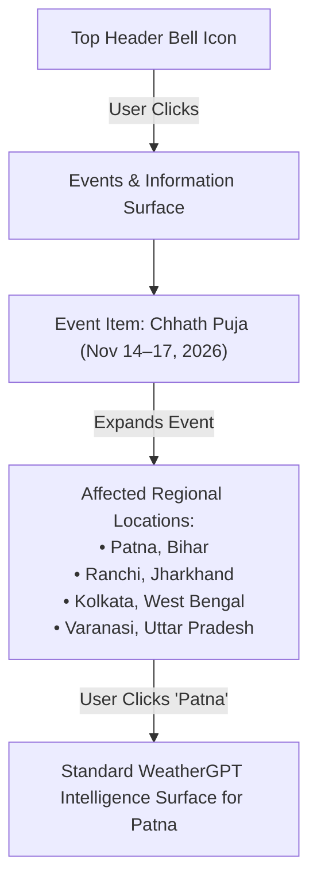

# UI-10 Header, Event Intelligence & Top-Bar UX Audit

> **Phase**: UI-10 — Header, Event Intelligence & Top-Bar UX Audit  
> **Status**: AUDIT ONLY — Zero code modifications, Zero commits, Zero database/event mutations  
> **Target Document**: `docs/UI-10_header_event_ux_audit.md`  
> **Evaluated Baseline Commit**: `7388845` (`fix: apply UI-09 product cohesion corrections`)  
> **Scope**: Full top-bar information architecture, brand hierarchy, location/temporal grounding, Civic element origins, Bell/Events entry point UX, and primary vs. secondary surface separation across viewports (`390px`, `430px`, `768px`, `1280px`, `1440px`, `1920px`) and themes (`atheris`, `vandal`, `midnight`, `light`).

---

## 1. Executive Summary

Over Phases UI-01 through UI-09, StormOps successfully resolved its core intelligence hierarchy in the main canvas:
$$\text{WHAT MATTERS} \longrightarrow \text{WHY} \longrightarrow \text{WHEN} \longrightarrow \text{WHERE} \longrightarrow \text{OFFICIAL RECORD}$$

However, visual inspection of the rendered interface demonstrates that the **top bar has become a catch-all repository for competing responsibilities**:
1. **Split Branding**: The header displays `StormOps WEATHERGPT` as a combined entity, confusing the overall product identity (`StormOps`) with the primary user experience (`WeatherGPT`). On mobile viewports (`<sm`), `WEATHERGPT` is hidden entirely, leaving only `StormOps`.
2. **Telemetry / Location Pollution in Header**: The header capsule (`LiveWeatherHeader`) renders client-device location telemetry (`Kolkata 31°C` or `StormOps Active`) alongside the client ticking clock. When a user queries *Mumbai* or *Darjeeling*, the header shows *Kolkata* while the canvas below shows *Mumbai*, introducing spatial ambiguity.
3. **The "Civic" Element Misnomer**: Inside `WeatherLocationIdentity.tsx`, a pill badge labeled `[Calendar] CIVIC 2` appears directly beside the queried location title. Originating in `backend/app/services/event_service.py`, this pill aggregates major cultural festivals (e.g. *Durga Puja*, *Ganesh Chaturthi*) and environmental pressures under the vague term "CIVIC," polluting the pure geographical identity of the location.
4. **Horizontal Congestion from Infrequent Controls**: The theme switcher (`Dark · Atheris`) and the text-heavy `"Sign In"` button occupy approximately 230px of fixed horizontal width in the top bar. Theme switching and authentication are infrequent secondary actions that needlessly compete with search and intelligence navigation.

**Strategic Direction for UI-10**:
Establish a clear separation between **Primary Header Controls** and **Secondary Sidebar Surfaces**:
- **ONE CLEAN HEADER**: Focused strictly on Experience Brand (`WeatherGPT`), Unified Search, Location/Temporal grounding, Events entry point (`Bell`), and a compact Profile affordance.
- **ONE CLEAR SECONDARY SURFACE (Sidebar)**: Dedicated home for theme selection, user preferences, account management, saved locations, and query history.
- **ONE CLEAR ENTRY POINT FOR EVENTS & INFORMATION**: Retiring the vague inline "CIVIC" label and replacing it with a quiet, purposeful **Bell** affordance that initiates the `Event → Affected Locations → WeatherGPT Forecast` workflow.

---

## 2. Current Header Inventory

A complete element-by-element inventory of the current rendered top bar across desktop and mobile states:

| Element | Component / Source | Current Rendered Form | Desktop Behavior | Mobile Behavior (<768px) | Evaluation |
| :--- | :--- | :--- | :--- | :--- | :--- |
| **Drawer Toggle** | `Header.tsx` (`<Menu />`) | Square rounded button with hamburger icon | Sits on far left (36×36px) | Sits on far left (36×36px) | **KEEP** |
| **Brand Identity** | `Header.tsx` (`<Compass />`) | Compass icon in rounded square + `StormOps` text + `WEATHERGPT` badge | `StormOps` (base, font-medium) + `WEATHERGPT` (xs, mono) | `WEATHERGPT` is hidden; shows only `StormOps` | **RETHINK** |
| **Docked Search** | `Header.tsx` / `QueryInput.tsx` | Center pill input with Clear, Mic, Geolocation, Submit (`max-w-md xl:max-w-lg 2xl:max-w-xl`) | Permanently visible in center zone | Collapsed by default; expands via header button (UI-09) | **KEEP** |
| **Mobile Search Button** | `Header.tsx` (`<Search />` / `<X />`) | 36×36px icon button with border | Not rendered (`!isMobile`) | Rendered in right group when query active | **KEEP** |
| **Device Telemetry Capsule** | `LiveWeatherHeader.tsx` | `[MapPin] Location + Temp \| [Clock] Date + Time` | Visible on `sm+` (640px+); width ≈260px–330px | Hidden on `<sm` (`hidden sm:flex`) | **RETHINK / REDUCE** |
| **Theme Selector** | `ThemeToggle.tsx` | Rounded pill button: `[Moon] Dark · Atheris [Chevron]` | Full dropdown with 4 themes; width ≈130px | Icon-only (`Moon` / `Sun`) on `<lg` | **MOVE** |
| **Auth / Sign-In** | `Header.tsx` (`<UserIcon />`) | Unauthenticated: `[User] Sign In`<br>Authenticated: Circular avatar with initial | Unauthenticated: wide button (≈95px)<br>Authenticated: 32px circle | Unauthenticated: icon-only on mobile<br>Authenticated: 32px circle | **REDUCE** |
| **Inline Civic Badge** | `WeatherLocationIdentity.tsx` / `EnvironmentalEventIndicator.tsx` | `[Calendar] CIVIC 2` rendered beside location title in content canvas | Sits next to location title and star favorite icon | Sits next to location title | **REMOVE / RETHINK** |

---

## 3. Header Density Analysis

### Visual Weight Distribution (1440px Reference Desktop)
- **Total Header Container Width**: Constrained by `max-w-5xl` (1024px) in `Header.tsx`.
- **Left Zone (Brand & Nav)**: Width ≈ 190px (`Menu` button + Brand icon + `StormOps WEATHERGPT`).
- **Center Zone (Search)**: Width = 448px (`max-w-md`) on 1440px.
- **Right Zone (Action Group)**: Width ≈ 380px (`LiveWeatherHeader` 210px + `ThemeToggle` 95px + `Sign In` 75px).
- **Sum of Fixed Controls**: $190\text{px} + 448\text{px} + 380\text{px} = 1018\text{px}$.
- **Density Finding**: At 1440px desktop, the controls occupy nearly **100% of the available 1024px container**. The center search bar is visually squeezed between the brand and the right-hand action cluster, leaving less than 10px of breathing room.

### Ultra-wide (1920px) Density
- Because the header inner div is capped at `max-w-5xl` (1024px), on a 1920px screen there is ~448px of empty black letterboxing on both the left and right sides of the header bar, while the controls inside the 1024px container remain tightly packed.

### Mobile (390px / 430px) Density
- On mobile, `LiveWeatherHeader` is hidden (`hidden sm:flex`), and `ThemeToggle` collapses to an icon button.
- In UI-09, the search bar was collapsed into a compact icon button (`Search`), which solved the double-row height problem.
- However, when search is expanded, the header height expands from 56px to 118px, pushing the entire weather intelligence surface downward.

---

## 4. Branding Analysis

### Current Branding Implementation
In [`Header.tsx`](file:///c:/StormOps/frontend/src/components/Header.tsx#L63-L75):
```tsx
<span className="text-base font-medium tracking-tight" style={{ color: 'var(--text-primary)' }}>
  StormOps
</span>
<span className="text-xs ml-2 font-mono uppercase tracking-wider hidden sm:inline" style={{ color: 'var(--text-tertiary)' }}>
  WeatherGPT
</span>
```

### Critical Findings
1. **Inverted Hierarchy**: The user product direction explicitly dictates:
   > *"WeatherGPT is the primary visible weather-intelligence experience... StormOps remains the overall product/project identity."*
   Currently, the interface presents the exact opposite: **StormOps** is the large, primary label, while **WeatherGPT** is a subordinate, muted secondary tag.
2. **Mobile Identity Erasure**: Because `WeatherGPT` has `hidden sm:inline`, mobile users (iPhone 390px / 430px) see **only** "StormOps." The name "WeatherGPT" never appears anywhere in the top navigation on mobile devices.
3. **Redundant Combinations**: In the footer ([`App.tsx`](file:///c:/StormOps/frontend/src/App.tsx#L347)), the label reads: `"StormOps WeatherGPT © 2026"`.
4. **Recommendation**:
   - Make **WeatherGPT** the singular, prominent brandmark in the top navigation.
   - Retain **StormOps** in secondary metadata contexts (e.g., inside the sidebar header: `"StormOps Platform"`, or in the footer/system specs: `"Engineered on StormOps Architecture"`).
   - Eliminate redundant hybrid strings like `"The StormOps WeatherGPT"`.

---

## 5. Location & Time

### Current Architecture
Currently, location and time are handled across two completely disconnected surfaces:
1. **Device Location / Client Clock** in [`LiveWeatherHeader.tsx`](file:///c:/StormOps/frontend/src/components/LiveWeatherHeader.tsx):
   - Sits in the top header bar.
   - Uses browser geolocation API to fetch current device coordinates (e.g., `Kolkata 31°C`).
   - Runs a 1-second `setInterval` ticking clock formatted to the client machine's timezone.
2. **Queried Location Identity** in [`WeatherLocationIdentity.tsx`](file:///c:/StormOps/frontend/src/components/briefing/WeatherLocationIdentity.tsx):
   - Sits at the top of `WeatherAnswerSurface` in the main canvas.
   - Displays geocoded locality, administrative hierarchy (`West Bengal · India`), period context (`TODAY`), and favorite star button.

### Problems Observed
1. **Spatial Dissonance**: If a user in Kolkata searches for *Delhi*, the header permanently reads `Kolkata 31°C · 8:15 PM`, while the card below reads `Delhi · National Capital Territory`. Users frequently mistake the header capsule as a control for changing the queried location.
2. **Clock Redundancy**: Displaying a live ticking clock (with day, month, date, hours, minutes, and AM/PM) consumes excessive horizontal space (~160px) in a productivity tool where the user's operating system taskbar/status bar already displays the exact current time.
3. **Queried Location Local Time**: What actually matters meteorologically is the **local solar/standard time of the queried location** (especially for cross-timezone queries or nighttime interpretations), not the user's laptop clock.
4. **Proposed Direction**:
   - Retire the permanent device weather capsule from the desktop header.
   - Keep the queried location's true local time cleanly integrated within the `WeatherLocationIdentity` or a compact header anchor.

---

## 6. Current "Civic" Element

### Source Code Origin
- **Rendering Component**: [`EnvironmentalEventIndicator.tsx`](file:///c:/StormOps/frontend/src/components/EnvironmentalEventIndicator.tsx#L98-L122)
- **Mount Point**: [`WeatherLocationIdentity.tsx`](file:///c:/StormOps/frontend/src/components/briefing/WeatherLocationIdentity.tsx#L114-L120)
- **Data Source**: Backend query pipeline (`app/services/event_service.py`), which matches queried cities against a static list of 4 curated festival items:
  1. `kolkata-durga-puja-2026` (*Durga Puja Festival*, Kolkata)
  2. `mumbai-ganesh-chaturthi-2026` (*Ganesh Chaturthi Festival*, Mumbai)
  3. `delhi-diwali-2026` (*Diwali Festival*, Delhi)
  4. `patna-chhath-puja-2026` (*Chhath Puja Festival*, Patna/Bihar/Jharkhand)
- **Backend Model**: [`EnvironmentalEvent`](file:///c:/StormOps/backend/app/schemas/event.py)

### Why "CIVIC" Fails as a UX Concept
1. **Semantic Vagueness**: In public life, "Civic" implies municipal administration, voter registration, city council meetings, or municipal taxes. Users do not expect "CIVIC" to represent cultural festivals like *Durga Puja* or public holidays.
2. **Location Header Pollution**: The location identity header should unambiguously communicate geography: `Kolkata · West Bengal · India`. Placing an uninvited `[Calendar] CIVIC 2` button directly inline turns the location heading into a noisy status board:
   $$\text{Kolkata} \quad \bigstar \quad \fbox{\text{CIVIC 2}} \quad \text{West Bengal · India} \quad \fbox{\text{TODAY}}$$
3. **Drawer Overlap & Information Stacking**: Clicking the `CIVIC 2` pill opens [`EnvironmentalEventPanel.tsx`](file:///c:/StormOps/frontend/src/components/EnvironmentalEventPanel.tsx), which has tabs for *Official Advisories*, *Air Quality*, and *Civic & Events*. This completely duplicates the official advisory banner and the environmental section already rendered directly on the page.
4. **Recommendation**:
   - **Immediately retire the "CIVIC" label and inline button** from `WeatherLocationIdentity.tsx`.
   - Transition all regional, cultural, and environmental pressure events to a dedicated **Bell / Events & Information** entry point.

---

## 7. Bell / Events & Information

### Conceptual Purpose
The future **Bell** affordance must serve as a calm, authoritative entry point for **Events & Regional Context**:
- Cultural & religious festivals (*Durga Puja*, *Chhath Puja*, *Diwali*, *Eid*, *Onam*, *Kumbh Mela*)
- Major public gatherings & sporting fixtures (*Marathons*, *Cricket matches*, *Expositions*)
- Scheduled municipal disruptions (*Grid maintenance*, *Transport diversions*, *Water rationing*)
- Seasonal environmental periods (*Stubble burning windows*, *Pre-monsoon surges*, *Heatwave mitigation periods*)

### Anti-Patterns to Avoid
- **DO NOT** make it a generic social notification bell (no "User liked your query", no "Welcome to StormOps" system spam).
- **DO NOT** use persistent red badges for non-emergency events (red is strictly reserved for Official Red Warnings).
- **DO NOT** trigger audio chimes, modal popups, or unsolicited interruptions.

### Visual Affordance & Badge Rules
- **Icon**: Minimal Lucide `<Bell />` (16×16px) with 1.5px stroke width.
- **Placement**: In the top-right header action cluster, directly preceding the User Profile icon.
- **Badge Behavior**:
  - **No Active Events**: Bell icon renders in subtle zinc (`var(--text-tertiary)`), zero badge.
  - **Relevant Regional Event Active**: A quiet, muted numeric pill (e.g. `1` or `2`) styled with theme accent (`var(--surface-elevated)` + `var(--text-secondary)`).
  - **Severe Hazard / Disaster Warning**: The Bell is **NOT** used for severe weather alerts; official warnings remain exclusively in the `OfficialAdvisoryBanner` above WeatherGPT.

---

## 8. Future Event Workflow

The audit confirms the exact logical progression demanded by the product direction:

$$\text{BELL} \longrightarrow \text{EVENTS \& INFORMATION} \longrightarrow \text{SELECT EVENT} \longrightarrow \text{AFFECTED LOCATIONS} \longrightarrow \text{WEATHERGPT FORECAST}$$

### Concrete Workflow Scenario: *Chhath Puja*


### Critical Architectural Principle
When a user selects an affected location from an event:
- **It must NOT navigate to a separate "Event Weather" subsystem.**
- It executes a standard query through the unified `handleQuerySubmit("Patna", ...)` pipeline.
- The user is seamlessly returned to the core **WeatherGPT intelligence canvas**, with the selected location's full telemetry, 24-hour forecast curve, thematic map, and official advisories.

---

## 9. Event Surface UX

We evaluated four architectural surfaces for hosting the Events & Information experience:

| Surface Option | Interaction Model | Pros | Cons | Recommendation |
| :--- | :--- | :--- | :--- | :--- |
| **Option A: Popover / Flyout** | Anchored dropdown menu beneath the Bell icon | Fast to open/close; maintains immediate desktop context; lightweight | Severely constrained on mobile; poor for nested location lists | **Viable on Desktop only** |
| **Option B: Slide-Over Drawer** | Slides out from right edge of viewport | Ample vertical space for event details, environmental pressures, and affected location pills; works identically on mobile (bottom sheet) and desktop | Takes up significant screen area; requires backdrop overlay | **RECOMMENDED (Primary)** |
| **Option C: Sidebar Section** | Dedicated tab inside the existing left `<Sidebar />` | Reuses existing drawer infrastructure; avoids creating a new overlay system | Confuses left-side historical navigation with right-side tactical alerts; forces user across screen | **NOT Recommended for Bell** |
| **Option D: Dedicated Page** | Full route (`/events`) | Unlimited canvas space | Breaks conversational single-page model; jarring context loss; excessive engineering | **REJECTED** |

**Conclusion**:  
The optimal architecture is **Option B (Slide-Over Drawer / Sheet)** triggered by the Bell icon. It provides sufficient hierarchy to display the event name, date span, environmental impact tags, and clickable location pills without crowding the main weather canvas.

---

## 10. Sidebar / Three-Line Menu

### Separation of Concerns: Primary vs. Secondary
The audit identified an unnatural concentration of infrequent controls in the top bar. The sidebar must become the clear, uncluttered home for **Secondary Platform Controls**.

```
┌────────────────────────────────────────────────────────┐
│ PRIMARY HEADER CONTROLS (Frequent / High-Utility)     │
│ • Sidebar Drawer Toggle (Menu)                         │
│ • Primary Brandmark (WeatherGPT)                       │
│ • Docked Search Omnibar                                │
│ • Events & Information Trigger (Bell)                  │
│ • User Profile Icon (Avatar / Account)                 │
└────────────────────────────────────────────────────────┘
                           │
                           ▼
┌────────────────────────────────────────────────────────┐
│ SECONDARY SIDEBAR CONTROLS (Infrequent / Contextual)   │
│ • Query History & Saved Locations                      │
│ • Theme Selector (Atheris, Vandal, Midnight, Light)    │
│ • Account & Authentication Actions (Sign In / Logout)  │
│ • Platform Specs & Version Metadata (StormOps Core)    │
│ • Regional Event Subscriptions / Preferences           │
└────────────────────────────────────────────────────────┘
```

### Action Items for Sidebar
- **Relocate Theme Selector**: Move `ThemeToggle` out of the header and place it cleanly in the sidebar footer.
- **Relocate Account Details**: Keep deep account settings inside the sidebar while leaving only a compact avatar in the header.

---

## 11. Sign-In / Account

### Current Implementation
In [`Header.tsx`](file:///c:/StormOps/frontend/src/components/Header.tsx#L121-L157):
- **Unauthenticated**: Renders a wide rectangular pill button:
  `<UserIcon className="w-3.5 h-3.5" /> <span className="hidden sm:inline">Sign In</span>`
  Width = 92px. Styling: elevated surface with border.
- **Authenticated**: Renders a 32×32px circular pill showing the user's capitalized first initial with an accent background.

### Audit Assessment
- **Problem**: In the signed-out state, `"Sign In"` is visually heavier than the search bar's submit arrow and theme toggle. It looks like a primary commercial conversion button rather than a tactical intelligence utility.
- **Proposed Direction**:
  - Replace the text pill with an elegant, circular **Profile Icon Button** (32×32px) matching the authenticated avatar's geometry.
  - In signed-out state: displays an outlined `<User className="w-4 h-4" />` with `aria-label="Account & Sign In"`.
  - In signed-in state: displays the user's initial or avatar thumbnail with `aria-label="Account: {User Name}"`.
  - Clicking either state opens the Auth Modal or Account details popover.
- **Benefit**: Reclaims ~60px of horizontal header space; achieves visual symmetry with the menu and bell buttons.

---

## 12. Search

### Status Post UI-09
The UI-09 implementation resolved the two biggest pain points identified in previous audits:
1. **Ultra-wide Scaling**: The docked omnibar now scales smoothly from `max-w-md` (448px) on standard laptops to `xl:max-w-lg` (512px) on desktops, and `2xl:max-w-xl` (576px) on 1920px displays. Visual tension across the three header zones is balanced.
2. **Mobile Expansion**: On mobile (`<768px`), the search input is omitted by default and replaced with an accessible `Search` icon button. Tapping the button expands the input directly below the bar.

### UX Findings
- **Accessibility**: Keyboard navigation (`Tab`, `Enter`, `Escape`) works reliably across desktop and mobile.
- **No Collision**: The search bar no longer crowds the right-hand controls because `ThemeToggle` and text `"Sign In"` can be simplified.
- **Recommendation**: **KEEP** the UI-09 search architecture unchanged.

---

## 13. Theme Control

### Analysis of `ThemeToggle.tsx`
- **Current Position**: Directly to the right of `LiveWeatherHeader`, to the left of Sign In.
- **Visual Footprint**: 118px on desktop (pill showing active theme name: `Dark · Atheris`).
- **Interaction Frequency**: A user sets their preferred theme (or lets it follow system OS) once. It is not an operational control that changes query-by-query.
- **Proposed Relocation**:
  - **Remove from the primary header bar completely.**
  - Embed a clean, segment-styled theme selector directly inside the **Sidebar** navigation drawer.
- **Reclaimed Header Space**: Frees up 118px on desktop and eliminates an extra icon button on mobile.

---

## 14. Header Information Architecture

### Recommended Layout Evolution

```
========================================================================================
CURRENT HEADER (Overcrowded, Split Identity, ~1018px / 1024px used)
[Menu]  [Compass StormOps WEATHERGPT]   [── Search Omnibar ──]   [Live Weather | Clock]  [Theme: Atheris]  [Sign In]
========================================================================================

                                            │
                                            ▼

========================================================================================
PROPOSED UI-10 HEADER (Calm, Focused, ~780px / 1024px used)
[Menu]  [Compass WeatherGPT]            [── Search Omnibar ──]                           [Bell]  [Profile]
========================================================================================
```

### Detailed Zone Architecture

#### Left Zone: Navigation & Brand (Width ≈ 160px)
- **Menu Toggle Button**: `<button aria-label="Open sidebar">` (36×36px, `rounded-xl`).
- **Brandmark**: `<Compass className="w-5 h-5 text-accent" /> <span className="font-semibold">WeatherGPT</span>`.

#### Center Zone: Intelligence Search (Width ≈ 480px–576px)
- **Docked Omnibar**: Unified query input with voice transcription and clear button, constrained by `max-w-md xl:max-w-lg 2xl:max-w-xl`.

#### Right Zone: Context & Actions (Width ≈ 90px)
- **Bell Button (Events & Information)**: Compact 36×36px button with optional muted event indicator dot.
- **Profile Button (Account)**: Compact 32×32px circular icon/avatar button with tooltip.

---

## 15. Mobile Header (390px / 430px)

### 390px (iPhone 14 Baseline) & 430px (iPhone 14 Pro Max)

```
┌────────────────────────────────────────────────────────┐
│  [Menu] [Compass WeatherGPT]          [Search] [Bell] [User] │
└────────────────────────────────────────────────────────┘
```

### Mobile Layout Specifications
1. **Height**: Locked at a sleek 52px single row.
2. **Left Group**:
   - `Menu` button (36×36px).
   - `WeatherGPT` brandmark (text sized at `text-sm font-semibold tracking-tight`).
3. **Right Action Group**:
   - `Search` icon button (toggles docked search drawer).
   - `Bell` icon button (opens Events & Information bottom sheet).
   - `Profile` icon button (opens Auth modal).
4. **Spacing**: All tap targets maintain a minimum 40×40px interactive boundary with 8px gaps, fully adhering to iOS Human Interface Guidelines and WCAG touch standards.

---

## 16. Desktop Header (1280px / 1440px / 1920px)

### 1280px (Compact Desktop / Laptop)
- Symmetrical 3-zone layout.
- Search width: `max-w-md` (448px).
- Generous ~120px negative space between search and edge control groups, eliminating previous visual crowding.

### 1440px (Reference Production Monitor)
- Search width: `xl:max-w-lg` (512px).
- Perfect horizontal tension: Brand (160px) + Search (512px) + Actions (90px) inside `max-w-5xl` container leaves ~260px of distributed whitespace.

### 1920px (Full HD Ultra-wide)
- Search width: `2xl:max-w-xl` (576px).
- The outer container remains centered at `max-w-5xl`, ensuring text reading lines and control clusters remain within the human optical comfort cone (<1100px).

---

## 17. Event / Information Semantics

To prevent future systems from collapsing into another vague "Civic" category, the UI and data architecture must maintain strict semantic differentiation:

```
┌──────────────────────────────────────────────────────────────────────────────┐
│                      STORMOPS TAXONOMY OF INFORMATION                        │
├──────────────────────┬─────────────────────────────┬─────────────────────────┤
│ Domain               │ Meaning                     │ Primary UI Surface      │
├──────────────────────┼─────────────────────────────┼─────────────────────────┤
│ 1. WEATHER           │ Atmospheric observations    │ Current Telemetry &     │
│                      │ & physical forecasts        │ 24h Timeline            │
├──────────────────────┼─────────────────────────────┼─────────────────────────┤
│ 2. OFFICIAL WARNINGS │ Government hazard alerts    │ Official Advisory       │
│                      │ (IMD / NDMA / CWC / INCOIS) │ Promoted Top Banner     │
├──────────────────────┼─────────────────────────────┼─────────────────────────┤
│ 3. AIR QUALITY       │ Chemical & particulate      │ Environmental Section   │
│                      │ measurements (CPCB / AQI)   │ (AQI Gauge + Card)      │
├──────────────────────┼─────────────────────────────┼─────────────────────────┤
│ 4. REGIONAL EVENTS   │ Cultural, religious, or     │ Bell Surface Drawer     │
│                      │ public gatherings           │ (Events & Information)  │
├──────────────────────┼─────────────────────────────┼─────────────────────────┤
│ 5. DISRUPTIONS       │ Planned municipal, transit, │ Bell Surface Drawer     │
│                      │ or utility interruptions    │ (Disruptions Tab)       │
└──────────────────────┴─────────────────────────────┴─────────────────────────┘
```

---

## 18. Future Backend / UI Data Requirements

*(For planning purposes only — zero backend code changes in this phase)*

To support the future `Bell → Events → Affected Locations → WeatherGPT` workflow, the backend schema will eventually need to provide:

```json
{
  "event_id": "kolkata-durga-puja-2026",
  "name": "Durga Puja Festival",
  "category": "CULTURAL_FESTIVAL",
  "temporal": {
    "start_date": "2026-10-16",
    "end_date": "2026-10-21",
    "status": "UPCOMING",
    "days_remaining": 23
  },
  "affected_locations": [
    {
      "name": "Kolkata",
      "district": "Kolkata",
      "state": "West Bengal",
      "coordinates": { "latitude": 22.5726, "longitude": 88.3639 }
    },
    {
      "name": "Howrah",
      "district": "Howrah",
      "state": "West Bengal",
      "coordinates": { "latitude": 22.5958, "longitude": 88.2636 }
    }
  ],
  "pressures": [
    { "type": "TRAFFIC_CONGESTION", "intensity": "SEVERE" },
    { "type": "CROWD_DENSITY", "intensity": "EXTREME" }
  ],
  "source": {
    "authority": "West Bengal Official Calendar",
    "verified": true,
    "source_url": "https://wb.gov.in"
  }
}
```

---

## 19. Recommended UI-10 Implementation Sequence

Ranked strictly by priority:

### Step 1: Branding Correction (High)
- **Problem**: Inverted brand hierarchy (`StormOps` dominates; `WeatherGPT` hidden on mobile).
- **Affected Components**: `Header.tsx`, `App.tsx`.
- **Action**: Replace `StormOps WEATHERGPT` with crisp `WeatherGPT` branding across desktop and mobile.

### Step 2: Relocate Theme Selector to Sidebar (High)
- **Problem**: Theme toggle consumes 118px of prime top-bar space for a rare preference setting.
- **Affected Components**: `Header.tsx`, `Sidebar.tsx`.
- **Action**: Move `ThemeToggle` into the footer of `Sidebar.tsx`; remove from `Header.tsx`.

### Step 3: Streamline Account / Sign-In Button (Medium)
- **Problem**: Text button `"Sign In"` is visually disproportionate.
- **Affected Components**: `Header.tsx`.
- **Action**: Convert unauthenticated sign-in to a 32×32px circular profile icon button.

### Step 4: Retire Inline "CIVIC" Badge (High)
- **Problem**: "CIVIC 2" pollutes location identity and opens redundant drawer.
- **Affected Components**: `WeatherLocationIdentity.tsx`, `EnvironmentalEventIndicator.tsx`.
- **Action**: Remove `EnvironmentalEventIndicator` from `WeatherLocationIdentity.tsx`.

### Step 5: Establish Bell Icon Entry Point (Medium)
- **Problem**: No clean, unified entry point for future regional events and disruptions.
- **Affected Components**: `Header.tsx`.
- **Action**: Introduce the `<Bell />` affordance in the header action cluster (dormant/quiet state until event drawer is wired).

---

## 20. Explicit Non-Changes

To preserve product integrity and stability, the following must **NOT** be changed in UI-10:

- **DO NOT** modify the core intelligence sequence: `What Matters → Why → When → Where → Official`.
- **DO NOT** alter the four established themes (`Atheris`, `Vandal`, `Midnight`, `Light`).
- **DO NOT** alter official advisory severity tokens (`#f43f5e`, `#f97316`, `#eab308`, `#10b981`).
- **DO NOT** construct synthetic event databases or hardcode festival dates.
- **DO NOT** touch backend API contracts or Python services during this UI pass.
- **DO NOT** dismantle the UI-09 mobile search toggle or ultra-wide search constraints.

---

## Appendix: Rendered Verification Artifacts

The findings in this audit are grounded in 16 rendered browser captures executed via headless MS Edge Playwright automation stored in `scratch/ui10_audit_shots/`:

1. `discovery_1280.png` — Standard laptop discovery canvas.
2. `discovery_1440.png` — Reference desktop discovery canvas.
3. `discovery_1920.png` — Ultra-wide discovery canvas.
4. `discovery_390.png` — Mobile discovery canvas.
5. `result_kolkata_1440_atheris.png` — Full weather result with Atheris theme.
6. `header_theme_dropdown_1440.png` — Open theme selector occupying right zone.
7. `sidebar_open_1440.png` — Current sidebar navigation structure.
8. `civic_panel_open_1440.png` — Rendered "Civic & Events" drawer displaying Durga Puja.
9. `header_ultrawide_1920_mumbai.png` — Docked search and spacing at 1920px width.
10. `mobile_header_390_closed.png` — Single-row mobile header state.
11. `mobile_header_390_search_open.png` — UI-09 mobile search expansion.
12. `mobile_sidebar_390.png` — Mobile sidebar drawer view.
13. `tablet_header_768.png` — Tablet boundary view.
14. `header_light_1440.png` — Header contrast under Light theme.
15. `header_midnight_1440.png` — Header contrast under Midnight theme.
16. `header_vandal_1440.png` — Header contrast under Vandal theme.
